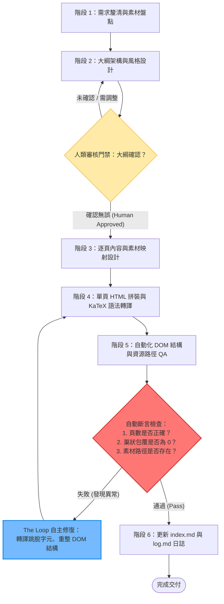

# AGENTS.md — AI 發展與實際運用 LLM Wiki 運作手冊

> **本文件是 Agent（AI 助理）維護此知識庫的最高遵循準則。**
> 任何參與本知識庫維護的 LLM Agent 必須完整閱讀並嚴格遵守本規範。

---

## 1. 核心哲學與定位 (Philosophy & Vision)

本知識庫遵循 Andrej Karpathy 的 **LLM Wiki** 範式，打造一張**「AI 技術與應用演進實戰地圖（AI Tech & Application Evolution Roadmap）」**：

- **聚焦技術與運用（Tech & Practical Applications）**：
  - 核心重點鎖定在：從早期基礎（如神經網路、Transformer）到前沿技術（Reasoning Models, Agentic Workflow, AI Coding），以及**「這些技術如何實際被使用」**。
  - **嚴格過濾非技術噪音**：各國普及率排名、宏觀總體經濟數據、地緣政治新聞原則上不獨立建頁，僅在與技術落地成本或環境限制直接相關時簡短提及。
- **由淺入深、零基礎友善（From 0 to 1 Intuition）**：
  - 避免堆砌枯燥的純數學公式或生硬理論，所有概念必須包含「生活化白話直覺（Intuition）」與「解決了過去什麼痛點」，讓完全零基礎的人也能看懂脈絡。
- **數學不作為唯一重點，但絕不可或缺 (Mathematical Foundations & Rigor)**：
  - 猶如專業教科書，概念與實踐頁面中**推導公式與數學形式化定義不可遺漏**。
  - 數學公式以獨立專章（例如 `## 形式化定義與數學基礎`）呈現，包含符號說明與物理意義，既不阻礙零基礎讀者的直覺理解，又為需要嚴謹工程實作與學術深究時提供不可動搖的底層錨點。
- **知識缺口雷達（Knowledge Frontier Radar）**：
  - Agent 在編織頁面時，必須主動引入先行基礎概念（如引用 `[[神經網路]]`、`[[Transformer]]`、`[[Tool Use]]`），未建立的頁面以反白雙鏈（Phantom Links）保留，讓使用者一目了然「自己還有哪些技術盲區需要補齊」。
- **人機分工**：
  - **人類（你）**：負責挑選高質量資料源（Sourcing）、探索發現、提問引導與戰略決策。
  - **Agent（LLM）**：身兼「AI 智庫圖書館員」與「知識庫工程師」，負責精讀、拆解、多頁面關聯更新、白話轉譯、維持索引階梯與日誌。
- **Obsidian 為 IDE，Agent 為工程師，Wiki 為 Codebase**：所有輸出必須完美適配 Obsidian 的雙向鏈結與知識圖譜渲染。

---

## 2. 語言與專有名詞規範 (Language & Terminology)

1. **核心語言**：以**繁體中文（台灣習慣用語）**為主要撰寫與對話語言。
2. **專有名詞保留**：所有 AI 領域的專有名詞、模型名稱、開源專案、架構術語**一律保留英文或中英並列**，切勿強行生硬翻譯。
   - 保留範例：`Reasoning Models`, `In-Context Learning`, `Attention Mechanism`, `Mixture of Experts (MoE)`, `Prompt Engineering`, `vLLM`, `Agentic Workflow`, `Retrieval-Augmented Generation (RAG)`, `Model Context Protocol (MCP)`, `Fine-tuning`, `Context Caching`, `Vibe Coding`, `SWE-Bench`。
3. **客觀嚴謹**：區分「廠商宣傳發布會說法（Marketing Claims）」與「獨立第三方評測 / 實際工程落地表現（Empirical Reality）」。

---

## 3. 知識庫目錄架構 (Repository Architecture)

知識庫嚴格劃分為三層架構：

```text
.
├── AGENTS.md                # 本規範（最高架構文件）
├── index.md                 # 內容總索引（包含「技術演進階梯圖」與分類目錄）
├── log.md                   # 時序操作日誌（記錄每次 Ingest、Lint、重大 Query、簡報生成）
│
├── raw/                     # 【第一層：不可變原始資料源 (Immutable Sources)】
│   ├── articles/            # 網路文章、技術部落格、官方公告
│   ├── papers/              # 學術論文筆記或原始全文（Markdown / PDF）
│   ├── cases/               # 企業實際落地案例、採訪、實務覆盤
│   └── assets/              # 原始文獻自帶之圖表、架構圖
│
├── assest/                  # 【素材層：靜態視覺資產庫 (Visual Asset Library)】
│   ├── 01_角色與頭像_3D公仔/ # 角色、擬人化機器人
│   ├── 03_AI與科技_可愛貼紙/ # 機器人手繪貼紙、科技小物
│   ├── 09_AI與開發工具Logo_彩色/ # 外部工具 Logo
│   └── 10_開發_彩色簡約/     # 終端機、程式碼、齒輪等工程向量圖
│
├── presentations/           # 【產出層：互動展示與簡報 (Presentations & Artifacts)】
│   └── *.html               # 依循工作流圖譜生成的高品質互動式投影片
│
└── wiki/                    # 【第二層：Agent 維護的活體知識庫 (Living Wiki)】
    ├── entities/            # 實體頁：公司/實驗室（OpenAI）、模型、工具（vLLM, Copilot）
    ├── concepts/            # 概念頁：理論、技術典範（Transformer, Tool Use, Agentic Workflow）
    ├── practices/           # 實務與應用頁：各領域落地架構、軟體工程生產力、安全防護、量化交易
    ├── comparisons/         # 橫向對比頁：模型對比、框架選型、開源 vs 閉源
    └── synthesis/           # 綜述與趨勢頁：技術架構演進脈絡、學習路徑指南
```

---

## 4. Obsidian 格式與排版標準 (Obsidian Standards)

### 4.1 雙向鏈結（Wikilinks）
- 廣泛且自然地使用 `[[頁面名稱]]` 或 `[[檔案名|顯示文字]]`。
- 大量運用未建頁鏈結（如引用尚未撰寫的 `[[機器學習基礎]]`、`[[反向傳播]]`），形成引導學習的知識缺口雷達。

### 4.2 結構化 YAML Frontmatter
每個 `wiki/` 檔案的開頭**必須**包含標準 YAML 區塊，以利 Dataview 查詢：

```yaml
---
title: 頁面完整標題
aliases: [英文別名, 常用縮寫]
type: entity | concept | practice | comparison | synthesis
tags: [ai, 大分類, 次分類]
created: YYYY-MM-DD
updated: YYYY-MM-DD
status: stable | evolving | deprecated
sources:
  - "[[raw/papers/xxx.md]]"
---
```

---

## 5. 核心操作工作流 (Workflows)

### 5.1 匯入工作流：逐步對話引導協議 (Interactive Ingest Protocol)
*本知識庫採用**逐步對話引導**，嚴禁在未與使用者對焦前直接批次修改大量檔案。*

1. **階段 1：精讀解析與核心摘要**：閱讀 Raw 資料，提煉技術突破點、實務使用方式、解決的痛點，過濾非技術經濟新聞。
2. **階段 2：提議觸及頁面（Fan-out Proposal）**：列出預計新建與更新的 Wiki 頁面清單。
3. **階段 3：人機對焦（Alignment Check）**：詢問使用者偏好與關注角度。
4. **階段 4：執行寫入與編織**：一次性建立/編輯各個 Wiki 頁面，注入 `[[wikilinks]]`，同步更新 `index.md` 與 `log.md`。
5. **階段 5：結算報告**：回報修改清單、雙向鏈結與知識缺口引導。

### 5.2 互動式簡報生成工作流協議 (Presentation & Artifact Graph Protocol)
*當需要將 Wiki 內容轉化為對外簡報、教學投影片（`presentations/*.html`）時，嚴禁從主題直接跳入代碼生成，必須嚴格執行「工作流圖譜（The Graph）」狀態機與門禁檢驗：*



- **階段 1（需求釐清與素材盤點）**：確認受眾程度（如零基礎白話直覺導向）、目標時長、互動操作需求，並盤點可用之圖片素材目錄（`assest/`）。
- **階段 2（大綱架構與風格設計）**：擬定頁面標題階層、邏輯演進流程，並選定視覺主題模板。
- **門禁 1（Human-in-the-Loop Gate，強制暫停點）**：
  - **鐵律**：Agent 必須將完整大綱輸出於對話框，**明確暫停並等待使用者回覆「大綱確認」**。未獲確認前，嚴禁擅自生成 HTML 內容。
- **階段 3（逐頁內容與素材映射設計）**：規劃每頁的圖文版型、白話生活譬喻、核心技術機制，以及對應挑選的向量/貼紙素材檔名。
- **階段 4（代碼編寫與轉譯）**：組裝單檔獨立運作的 HTML 投影片，包含 CSS 樣式、JavaScript 鍵盤切換監聽、KaTeX 公式相容設定。
- **階段 5 與門禁 2（自動化 QA 斷言門禁）**：檔案寫入磁碟後，Agent 必須主動執行測試腳本，自動檢查：
  1. DOM 樹結構：根容器下的 `.slide` 元素數量必須精確等於規劃頁數，且**巢狀嵌套數必須為 0**。
  2. 靜態資源完整性：所有 `` 的 `src` 路徑必須在檔案系統真實存在（0 missing）。
  3. 若斷言失敗，觸發 **The Loop 自主修復迴圈**，直到全部通過方可放行。
- **階段 6（收尾日誌）**：同步更新 `index.md` 專題簡報導航，並於 `log.md` 記錄版本迭代細節。

---

## 6. 來源溯源與防幻覺鐵律 (Strict Grounding & Provenance)

> **鐵律宣告：`raw/` 是本知識庫唯一的真相來源（Source of Truth）。嚴禁 Agent 脫離實體文件憑空捏造！**

1. **嚴禁無源生成 (No Ungrounded Generation)**：
   - 所有 `wiki/` 頁面必須在 Frontmatter 的 `sources:` 欄位明確指向 `raw/` 內的真實來源檔案（例如 `sources: ["[[raw/papers/xxx.md]]"]`）。
   - **嚴禁**在未有 `raw/` 資料支撐的情況下，擅自憑藉 Agent 自身的模型預訓練記憶直接新建 Wiki 內容。
2. **知識缺口補齊程序 (Knowledge Gap Acquisition Protocol)**：
   - 當使用者想要補齊某一基石或前沿概念（例如想建立 `[[神經網路]]`、`[[Transformer 架構]]`、`[[Tool Use]]`），但 `raw/` 中尚無對應文件時，**Agent 必須立即暫停（Halt）寫入**。
   - **合規處理途徑**：
     - **途徑 A（人類主導）**：由使用者提供文章網址、Markdown 檔或 PDF 論文。
     - **途徑 B（Agent 提議推薦書單）**：Agent 僅能列出學界或業界公認的「經典論文、權威技術規格或權威白話教學清單（包含論文名、作者、年份與 arXiv 連結）」，請使用者審核。**只有當使用者明確核准下載/收錄特定來源並存入 `raw/` 後，方可依規 Ingest。**

---

## 7. 頁面範本參考 (Templates)

### 7.1 概念頁標準範本 (`wiki/concepts/*.md`)
```markdown
---
title: 概念名稱
aliases: [英文縮寫, 別名]
type: concept
tags: [ai, 技術分類]
created: YYYY-MM-DD
updated: YYYY-MM-DD
status: evolving
sources: []
---

# 概念名稱

## 一句話白話直覺 (Intuition)
用最生活化、零基礎也能秒懂的譬喻解釋這個技術是什麼。

## 它解決了過去什麼痛點？
- 過去的技術（例如 [[早期技術名稱]]）有什麼瓶頸或限制？
- 本技術如何突破該瓶頸？

## 核心機制與工作原理 (Mechanism)
- 關鍵演算法或架構組成（圖解或條列）
- 配合 [[相關概念]] 的協同運作方式

## 形式化定義與數學基礎 (Mathematical Foundations)
- 形式化定義（狀態空間、機率分佈、目標函數、損失函數）
- 關鍵公式推導與參數物理意義說明

## 實務上怎麼用？（Tools & Application）
- 目前主流支援工具或開源庫：[[相關工具/模型]]
- 典型使用流程與最佳實踐範例

## 知識前沿與學習階梯 (Prerequisites & Frontier)
- 前置知識（若不懂建議先讀）：[[前置概念A]], [[前置概念B]]
- 進階延伸：[[進階概念C]]
```

---

## 8. 簡報視覺風格、素材庫與渲染防禦守則 (Presentation, Style & Asset Standards)

### 8.1 視覺風格標準：親和趣味圖解風 (Playful & Visual)
為落實「由淺入深、零基礎友善」的核心哲學，所有產出的簡報（`presentations/*.html`）應優先採用親和趣味圖解風：
1. **視覺基調**：明亮溫潤米白色背景（`#f7f5f0`），搭配高對比深灰文字（`#2d3748`），捨棄冰冷純黑或生硬企業深藍。
2. **容器與卡片**：大圓角卡片設計（`border-radius: 16px ~ 24px`），搭配柔和擴散陰影（`box-shadow: 0 10px 25px rgba(0,0,0,0.05)`）與淡米灰微邊框。
3. **色彩計畫**：大量採用馬卡龍柔和色彩標籤（薄荷綠 `#e6f4ea`、柔粉 `#fce8e6`、淡天藍 `#e8f0fe`、暖橙黃 `#fef7e0`、淡紫 `#f3e8fd`），活潑引導視覺焦點。
4. **雙重層次（Dual-level Depth）**：
   - 上半部：生動白話比喻與貼紙插圖（生活化 직覺）。
   - 下半部 / 獨立附屬卡片：精確 KaTeX 數學推導與參數物理意義（學術嚴謹性）。
5. **互動標準配置**：
   - 鍵盤導航：`←` / `→`、`PageUp` / `PageDown`、`Space`。
   - 全螢幕播放：按 `F` 鍵進入全螢幕，按 `ESC` 退出。
   - 進度指示：頂部即時寬度進度條、右下角頁碼計數器。

### 8.2 素材庫（`assest/`）規格與引用鐵律
1. **實體目錄路徑**：素材庫統一存放在專案根目錄的 `assest/`（**注意實體資料夾拼寫即為 `assest/`**）。
2. **HTML 相對路徑**：從 `presentations/*.html` 引用時，路徑必須精確撰寫為：`../assest/<子目錄名稱>/<檔名>`。
3. **實體驗證鐵律 (Strict Asset Provenance)**：
   - **嚴禁憑空捏造素材檔名**。生成前必須使用命令列盤點實體目錄內存在的素材檔名。
   - 生成後必須自動執行腳本檢驗：`Missing Images Count == 0`。
4. **素材語義對應**：
   - `assest/03_AI與科技_可愛貼紙/`、`assest/01_角色與頭像_3D公仔/`：適用於白話譬喻、大腦思考、破冰互動、外包工程師比喻等。
   - `assest/09_AI與開發工具Logo_彩色/`、`assest/10_開發_彩色簡約/`：適用於落地工具（Claude, Cursor, GitHub, Python, Terminal）與系統架構圖示。

### 8.3 防禦性 HTML/KaTeX 編譯守則（避坑指南）
在生成單檔 HTML 簡報時，為避免瀏覽器 HTML 解析器崩潰，必須嚴格遵守以下防禦性規則：

1. **LaTeX 小於/大於符號強制轉義鐵律（Prevent Tag Ingestion）**：
   - **出錯根源**：若在 HTML 內文中或 KaTeX 區塊直接撰寫未轉義的 `<` 符號（例如 `x_{<t}`、`z_{<k}`、`w_{<m}` 或 `（< 10B 參數）`），瀏覽器的 HTML5 解析器會將 `<t`、`<k`、`<m` 誤認為是「自訂未閉合標籤」，導致其後所有 `</div>` 閉合標籤全數錯位，將後續所有投影片強制巢狀塞入前一頁內部，造成**「第 5 頁後畫面全部空白」**的毀滅性 Bug。
   - **強制規範**：所有包含在 HTML 內容中的小於與大於號，**必須強制轉譯為 HTML Entity**：
     - `<` 轉為 `&lt;`（例如寫為 `x_{&lt; t}`、`z_{&lt; k}`、`（&lt; 10B 參數）`）
     - `>` 轉為 `&gt;`
2. **自動化 DOM 樹結構斷言（Automated QA Assertion）**：
   產出 HTML 檔案後，Agent **必須主動在背景執行測試腳本**，驗證 DOM 樹狀態：
   ```python
   # 驗證投影片總數與層級結構
   slides = soup.find_all(class_='slide')
   assert len(slides) == expected_slide_count, "投影片總數不符！"
   for s in slides:
       assert s.parent.has_attr('class') and 'deck-container' in s.parent['class'], "Slide 被非法巢狀包覆！"
   ```

---

*本文件持續隨知識庫發展自我迭代更新。*
