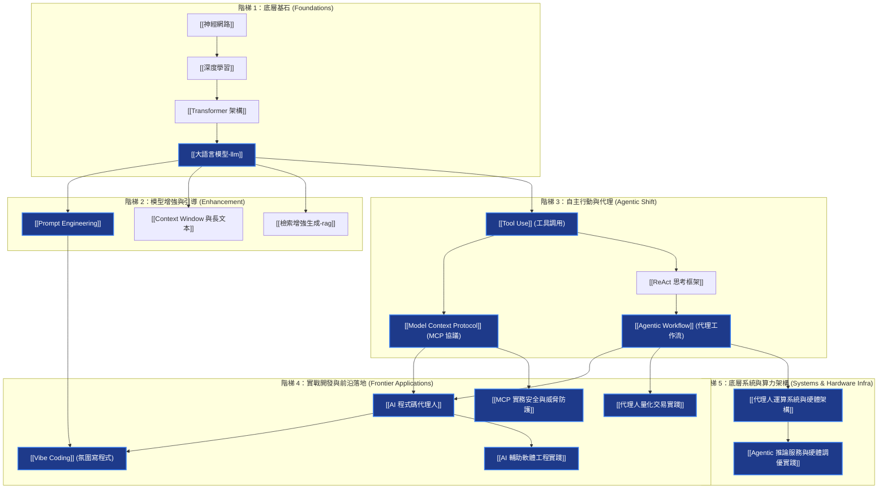

# AI 發展與實際運用 — 知識庫總索引 (Index)

> 歡迎查閱 **AI 發展與實際運用實戰地圖**！本知識庫專注於追蹤前沿 AI 進展與實踐應用，並為完全零基礎的學習者提供由淺入深的知識階梯。

---

## 🗺️ 從 0 到 1：AI 技術演進階梯圖 (AI Learning Roadmap)

> **圖譜閱讀指引**：
> - 🟩 **深色已點亮節點**：代表本庫**已收錄**並建立完整白話直覺、核心機制、數學基礎與實戰指南。
> - ⬜ **未建頁連結（反白）**：代表當前的**待探索知識缺口（Knowledge Gaps）**，未來將由你審核文獻後逐步補齊。

---

## 💡 核心概念與技術原理 (Concepts)
- [[大語言模型-llm|大語言模型 (LLM)]] — 讀破萬卷書的百科全書天才：自回歸交叉熵損失、In-Context Learning 湧現與 Scaling Laws 縮放定律。
- [[Prompt Engineering|Prompt Engineering 與思維鏈]] — 為天才大腦搭建思維鷹架：CoT 條件機率分解、測試時計算量擴展（Test-time Compute）與多數決自洽性。
- [[Agentic Workflow|代理人工作流與多智能體協作]] — 超越單次生成：POMDP 形式化、貝葉斯信念更新、四大架構（循序/疊代/階層/編排）與確定性硬門禁。
- [[Tool Use|Tool Use 工具調用]] — 替思考大腦裝上機械手：波茲曼機率工具選擇、CFG 語法約束生成與狀態轉移。
- [[Model Context Protocol|Model Context Protocol (MCP)]] — AI 界的 USB-C 通用協議：複雜度解耦 $\mathcal{O}(M \cdot N) \to \mathcal{O}(M+N)$、Host/Client/Server 架構。
- [[AI 程式碼代理人]] — 從編輯器自動補全進化為可自我測試、自主提交 PR 的工程代理人。
- [[Vibe Coding]] — 以自然語言與直覺主導的次世代開發新範式，大幅降低軟體創作門檻。
- [[代理人運算系統與硬體架構]] — 拆解 Agent 執行時在 CPU-GPU 頻繁打乒乓球的硬體失配問題，包含 Top-Down 微架構分析與三大軟體角色。
- *待建立基石缺口*：[[神經網路]], [[Transformer 架構]]

---

## 🛠️ 實體庫：模型、工具與平台 (Entities)
### 開發工具與代理平台 (Tools & Platforms)
- [[GitHub Copilot]] — 從 IDE 代碼補全演進為整合終端 CLI 與自主 Agent PR 的綜合開發平台。

### 前沿模型實體 (Frontier Models)
- *待建立知識缺口*：[[Claude Opus 4.5]], [[OpenAI Codex]], [[GPT-5]]

---

## 🚀 實務落地與工程實踐 (Practices)
- [[AI 輔助軟體工程實踐]] — 現代團隊如何結合 CI/CD、測試防護網與 Agentic Workflow 提升 78% 代碼生產力，以及面對 Jevons 效應的組織變革。
- [[MCP 實務安全與威脅防護]] — 拆解 MCP 生命週期三大攻擊面（工具流劫持、沙盒逃逸、安裝器欺騙）與實務防護手冊。
- [[代理人量化交易實踐]] — 結合均值-變異數最佳化與 Black-Litterman 模型的五階段交易管線，破解「回測幻象」與硬門禁防護。
- [[Agentic 推論服務與硬體調優實踐]] — 微軟 Azure 與學界提出的 Agora 原型，運用 MILP 混合整數規劃整併 GPU、CPU 閒置週期收割與任務綁核。

---

## 📽️ 專題簡報與互動展示 (Presentations & Slides)
- [presentations/ai-agent-principles-and-usage.html](file:///Users/user/Desktop/LLM%20Wiki%20AI/presentations/ai-agent-principles-and-usage.html) — **《AI Agent 的核心原理與實務運用全指南》**（19 頁親和趣味圖解風互動式 HTML 簡報，圖解 The Loop 自主迴圈、The Graph 狀態機工作流、MCP 與 AGENTS.md 工具規範，支援全螢幕、鍵盤切換與 KaTeX 數學渲染）。

---

## 📚 原始文獻庫 (Raw Sources)
1. [[raw/papers/microsoft-ai-diffusion-q1-2026.md|Microsoft AI Economy Institute (2026 Q1) — Global AI Diffusion Report]]
2. [[raw/papers/mcp-landscape-security-2025.md|Hou et al. (ACM, 2025) — Model Context Protocol (MCP): Landscape, Security Threats, and Future Research Directions]]
3. [[raw/papers/agentic-quantitative-trading-survey-2026.md|Hua et al. (arXiv, 2026) — Agentic Quantitative Trading: A Survey of Workflows, Systems, and Evaluation]]
4. [[raw/papers/architectural-implications-agentic-ai-2026.md|Yang et al. (arXiv, 2026) — Architectural Implications of Agentic AI Workflows]]
5. [[raw/papers/gpt3-few-shot-learners-2020.md|Brown et al. (NeurIPS, 2020) — Language Models are Few-Shot Learners (GPT-3)]]
6. [[raw/papers/chain-of-thought-prompting-2022.md|Wei et al. (NeurIPS, 2022) — Chain-of-Thought Prompting Elicits Reasoning in Large Language Models]]
